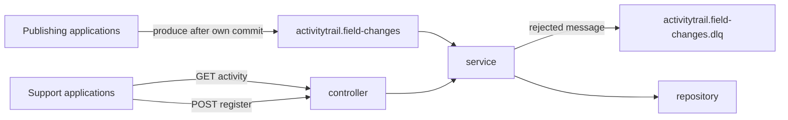

# Activity Trail architecture

Version 1 runs as one Java 21 process on Spring Boot 4.1.2. Gradle builds it. The process serves HTTP and starts the Kafka consumer when it boots.

The product rules are in [prd.md](prd.md). This document is the shape of the code.

## Packages

The application is one Gradle module. The layers are packages:

| Package | What it is |
| --- | --- |
| `activitytrail.controller` | HTTP. `FieldActivityController` is the register POST and the history GET. |
| `activitytrail.service` | `FieldActivityService` registers an application, stores a Kafka event, and reads activity. `FieldChangeConsumer` starts with the process and calls the service. |
| `activitytrail.repository` | `FieldActivityRepository` and the PostgreSQL implementation. This is the package to change for another database. |

`ActivityTrailApplication` starts the process. The controller calls the service. The service calls the repository. A host that wants a different database replaces `PostgresFieldActivityRepository` and leaves the controller and the service in place. `db/postgres` applies only to the PostgreSQL implementation.

## What starts

`java -jar build/libs/activitytrail.jar --spring.profiles.active=local`, run from the repository root so Flyway can read `db/postgres`. The profile is `local`, `qal`, `e2e`, or `prod`.

Shared behavior is in `application.properties`. The database URL and the Kafka brokers are in `application-local.properties`, `application-qal.properties`, `application-e2e.properties`, and `application-prod.properties`. QAL, E2E, and prod take `DATABASE_URL`, `KAFKA_BROKERS`, and `KAFKA_SASL_JAAS` from the environment. `PostgresRepositoryConfiguration` uses the DataSource Spring Boot builds from those properties. `FieldChangeKafkaConfig` sets manual acknowledgment.

On startup the process:

1. Connects to PostgreSQL with `spring.datasource.url` and applies `db/postgres`.
2. Listens on port 8080.
3. Joins Kafka group `activitytrail` and consumes `activitytrail.field-changes`.

The consumer acknowledges a record after the row is stored, after a duplicate is recognized, or after the dead letter is published. A database error is not acknowledged. The listener retries that record.

The topic is `activitytrail.field-changes` and the dead-letter topic is `activitytrail.field-changes.dlq`.

## HTTP

| Method | Path | Result |
| --- | --- | --- |
| `POST` | `/v1/operator/applications` | Registers an application id. 201 on success, 409 if that id already exists, 400 `validation_failed` when the body is not valid. |
| `GET` | `/v1/applications/{applicationId}/objects/{objectName}/{objectId}` | Activity for one object. 200 with `items`, including an empty list. 404 if the application was never registered. 403 if it is disabled. 400 `invalid_query` when the query is not valid. 400 `invalid_cursor` when the cursor is unreadable or does not match the filters sent with it. |
| `GET` | `/health` | 200 `{"status":"ok"}` when the database answers `SELECT 1`. 503 `{"status":"not_ready"}` otherwise. |

A `/v1` error body is `{"error":{"code":"...","message":"..."}}`.

`POST` accepts `application_id`, `display_name`, and an optional `retention_days`. Omitting `retention_days` stores `RETENTION_DAYS_DEFAULT`, which is 365 unless the host changed it. JSON `null` keeps that application's rows. A number must be from 1 to 3650.

The GET accepts `field`, `from`, `to`, `limit` (1 to 200, default 50), and `cursor`. `from` is inclusive and `to` is exclusive. `from` equal to `to`, or later than `to`, is `invalid_query`. `next_cursor` is the token for the following page. The response keeps null old and new values, so a cleared field is visible.

The service does not authenticate these calls. The host puts the process on a private network or behind a gateway. Who may produce to the topic, and who may join the consumer group, is the host's Kafka ACLs. A host that needs the check inside the process extends this code.

## Storing a message

`FieldChangeConsumer` handles each record:

1. `FieldChangeParser` checks the JSON, the change shape, and the message key. The key is `{application_id}:{object_name}:{object_id}` and must match the body. The parser computes a SHA-256 hash of the canonical body. The client does not send the hash.
2. An unknown application id is dead-lettered as `unknown_application`. A disabled application is dead-lettered as `application_disabled`.
3. `updated_at` more than five minutes ahead of the database clock is dead-lettered as `validation_failed`.
4. `FieldActivityRepository.storeFieldChange` inserts one row into `field_activity_trail`. The same `event_id` and the same hash is stored once. The same `event_id` and a different hash is dead-lettered as `event_conflict` and does not overwrite the row.

Dead-letter reasons are `invalid_json`, `validation_failed`, `unknown_application`, `application_disabled`, and `event_conflict`. The dead-letter body is `reason`, `failed_at`, and the original text. The header is `X-Activity-Trail-Reason`.

`change_type` is `set`, `update`, or `clear`. It decides which of the old and new values must be present. `correlation_id` groups the fields of one save. `body_hash` is how a redelivery is recognized.

## Retention

`RETENTION_ENABLED=true` is the default. At 03:00 UTC `ExpiredFieldActivityCleanup` deletes rows whose `updated_at` is older than that application's `retention_days`, 5000 rows at a time, under advisory lock `8142001`. A disabled application is still deleted when it has a window. An application with `retention_days` null is skipped. `RETENTION_ENABLED=false` does not create that bean, so nothing is deleted. The schema creates `retention_run`. The cleanup does not insert into it.

## Replacing PostgreSQL

`FieldActivityRepository` is the database API. `PostgresFieldActivityRepository` is the implementation in the `repository` package, created by `PostgresRepositoryConfiguration`.

To use another database, replace `PostgresFieldActivityRepository` and the bean in `PostgresRepositoryConfiguration`. The controller and the service keep calling `FieldActivityRepository`.
